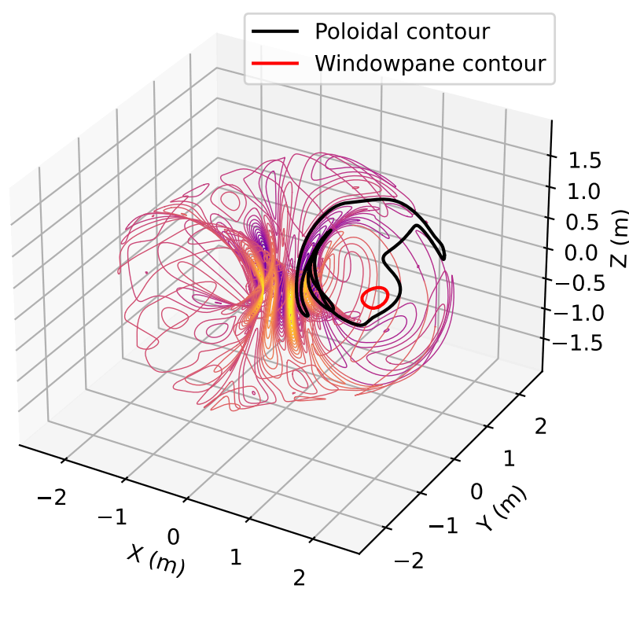

Homepage
========

Welcome to the documentation for `QUADCOIL <https://github.com/lankef/quadcoil>`_, 
the stellarator coil complexity proxy/global coil optimizer!

QUADCOIL is a global coil optimization code that approximates coils with a smooth sheet current. 
In other words, it's a "winding surface" code. However, unlike other winding surface codes, QUADCOIL:

- Supports constrained optimization.
- Supports non-convex quadratic penalties/constraints, such as curvature 
  :math:`\mathbf{K} \cdot \nabla \mathbf{K}`.
- Includes robust winding surface generators that do not produce self-intersections.
- Calculates derivatives with respect to plasma shape, winding surface shape, objective weights, and constraint thresholds.

Installation
------------

QUADCOIL requires Python 3.11 or newer, and depends on JAX, Lineax, Optimistix, Optax, and slsqp-jax. Since JAX installation can be platform-specific, see the JAX installation guide `here <https://docs.jax.dev/en/latest/installation.html>`_.

For the most up-to-date version, clone the `QUADCOIL source files <https://github.com/lankef/quadcoil>`_, 
and then run:

.. code-block:: bash

   pip install .

Alternatively, a stable version of QUADCOIL can also be installed from `PyPI <https://pypi.org/project/quadcoil/>`_:

.. code-block:: bash

    pip install quadcoil

Validating the installation
------------------------------

The installation can be validated by running the :doc:`example notebooks <examples/index>`
or the unit tests. To run all unit tests, run from the repository root:

.. code-block:: bash

    cd tests
    python -m unittest discover

To run a single test, for example:

.. code-block:: bash

    cd tests
    python -m unittest test_regcoil.QuadcoilKTest.test_regcoil

Tests that compare against Simsopt or DESC are skipped automatically when those
packages are not installed. The Simsopt comparisons require Simsopt's ``regcoil`` 
branch, which is not completely merged into the main branch as of this writing.

Contact
-------

Please contact `Lanke Fu <mailto:lanke_fu@outlook.com>`_ at CIMS for questions and bug reports.

Publications
------------

1. `Global stellarator coil optimization with quadratic constraints and objectives <https://doi.org/10.1088/1741-4326/ada810>`_
2. `A flexible and differentiable coil proxy for stellarator equilibrium optimization <https://pubs.aip.org/aip/pop/article/33/6/062506/3395906>`_

.. toctree::
   :maxdepth: 1
   :caption: List of contents

   self
   math
   solvers
   tutorial_inputs
   tutorial_outputs
   tutorial_to_simsopt
   tutorial_misc_outputs
   quantity
   examples/index
   quadcoil
   version_history
