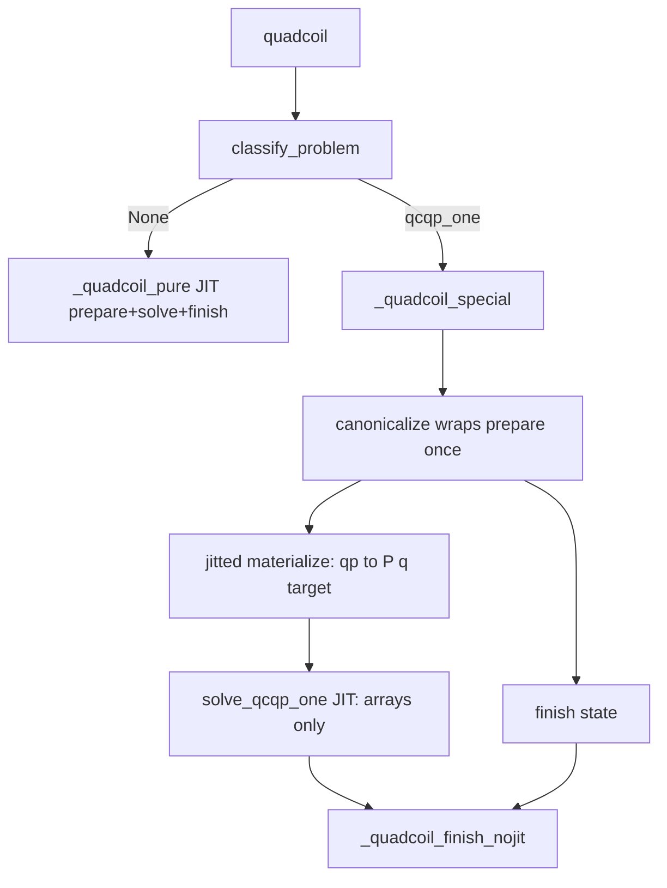

# JIT-capable special solvers (wrap prepare + jitted materialize)

Special-path canonicalize wraps prepare once, then jitted materialize builds array `problem_vars` (`P`, `q`, `target`). `solve_qcqp_one` is jitted on those arrays only.

YAGNI kept: no `c_f`; `problem_kwargs={}` for `qcqp_one`; no compile-cache unit test; no `verbose` inside jitted solve. Optimistix bisection stays.

## Chosen approach

**Wrap:** [`canonicalize`](src/quadcoil/solvers/special/canonicalize.py) owns the special-path setup façade. It calls [`_quadcoil_prepare_nojit`](src/quadcoil/quadcoil.py) **once** (do not rebuild surfaces/`qp` a second time) and returns finish `state` plus `problem_vars`. **Materialize** (Hessians/grads → `P_*`, `q_*`, `target`) runs inside a **`jax.jit`** function so that cost is compiled and reusable when traced inputs change.

Do **not** JIT all of canonicalize: finish `state` contains Python callables and other non-array values. Only materialize (and solve) are jitted.



**Generic path unchanged:** `_quadcoil_prepare_nojit` stays inside `_quadcoil_pure`.

## Goal

- `canonicalize(problem_class, **kwargs) -> state, problem_vars, problem_kwargs`
- `problem_vars`: traced arrays only
- `problem_kwargs`: **`{}` for `qcqp_one`**
- `solve_qcqp_one(x_init, problem_vars, **solver_options)` — no prepare callables
- **`jax.jit` + `static_argnames`** only (no `filter_jit`)
- Same static structure → no recompile of **materialize** or **solve** when only `plasma_dofs` / `constraint_value` / `x_init` change

## Canonicalize (wrap)

### Façade

```python
def canonicalize(problem_class, **kwargs):
    kwargs = {**kwargs, 'smoothing': None, 'merge_constraints': False}
    state = _quadcoil_prepare_nojit(**kwargs)   # once: qp, dofs, finish/KKT plumbing
    problem_vars = _materialize_qcqp_one_jit(   # jitted; see below
        state['qp'], state['x_flat_init'], ...traced target/unit pieces...,
        # static: objective/constraint names, precond structure, …
    )
    return state, problem_vars, {}
```

Do **not** pass `state['f_precond']` / `g_precond` into `solve_*`.

### Jitted materialize

`_materialize_qcqp_one` is `@partial(jax.jit, static_argnames=...)`.

**Traced inputs:** `qp` (pytree), `x_init` (or zeros of length `n`), scaled `target`, and any other array unit/precond factors needed.

**Inside the jit** (so AD/operator build is compiled): rebuild the scaled objective / uncentered constraint residual from `qp` using the same quantity APIs prepare uses (helpers shared with prepare where practical — not a second surface build). Then:

- `P_f = hessian(f0)(x_ref)`, `q_f` from `grad(f0)` (no `c_f`)
- `P_g`, `q_g`, `c_g` for uncentered `g0` (constraint value **not** baked into `g0`)
- `target`: scaled bound, traced

**Why not `hessian(state['f_precond'])` as a static callable arg:** that reintroduces callable-identity recompiles. Defining `f0`/`g0` **under** the materialize trace (from traced `qp` + static names) folds them into the jaxpr.

Validate shapes (`P_f` square, `target` scalar) with `eval_shape` / asserts as appropriate.

### Finish state

Prepare’s full `state` dict is returned for [`_quadcoil_finish_nojit`](src/quadcoil/quadcoil.py). Its callables are for metrics/KKT only. Out of scope: eliminating prepare for finish or JITting finish.

## Solve (`qcqp_one`)

```python
@partial(jax.jit, static_argnames=('root_maxiter',))
def _solve_qcqp_one_jit(
    x_init, problem_vars,
    lam_init, lam_grow, lam_max, root_tol, ctol,
    *, root_maxiter,
):
    # (P_f + lam P_g) x = -(q_f + lam q_g)
    # g(x) = 0.5 x P_g x + q_g·x + c_g - target
    ...
```

| Static | Traced |
|--------|--------|
| `root_maxiter` | `x_init`, `problem_vars`, `lam_*`, `root_tol`, `ctol` |

Cases (unchanged), with explicit `P`,`q` linear solves (not physics AD each step):

1. \(x_f = -P_f^{-1} q_f\); if \(g(x_f)\le 0\) → unconstrained.
2. Else \(x_g = -P_g^{-1} q_g\); if \(g(x_g)>0\) → infeasible.
3. Else bracket λ, then **`optimistix.root_find` + `optx.Bisection`** on \(g(x(\lambda))=0\).

Fixed return pytree under `lax.cond` (`fin_z` length-1; `status_code` int). Map `status_code` → `status` string outside jit. Resolve `root_tol=None` → `10*eps` outside jit. No verbose inside jit.

## Wiring

[`_quadcoil_special`](src/quadcoil/quadcoil.py):

1. `state, problem_vars, problem_kwargs = canonicalize(problem_class, **kwargs)`
2. `solve_results = solve_special(problem_class, state['x_flat_init'], problem_vars, problem_kwargs, solver_options)`
3. `status_code` → `kkt_mode` → `_quadcoil_finish_nojit(state, ...)`

[`solve_special`](src/quadcoil/solvers/special/__init__.py): `(x_init, problem_vars, problem_kwargs, ...)` → `solve_qcqp_one`.

## Recompilation behavior (expected)

- **Materialize JIT:** traced `qp` / `target` / `x_ref`; static names and structure → no recompile on plasma/target sweeps.
- **Solve JIT:** traced arrays + `root_maxiter` static → no recompile on `x_init` / `target` / operator values.
- **Prepare** still runs eagerly once per special call for finish callables (acceptable; not the fused hot path).
- Generic `_quadcoil_pure` unchanged.

## Tests

- Update [`tests/test_qcqp_one.py`](tests/test_qcqp_one.py) / special classify e2e for wrap canonicalize → array `problem_vars` → solve.
- Unconstrained / active / infeasible still hold.
- No dedicated JIT-cache unit test.

## Out of scope

- Eliminating prepare for finish/KKT
- JIT of `_quadcoil_finish_nojit`
- Other special classes beyond `qcqp_one`
- Changing `classify_problem` rules
- `equinox.filter_jit`
- Compile-cache assertions
